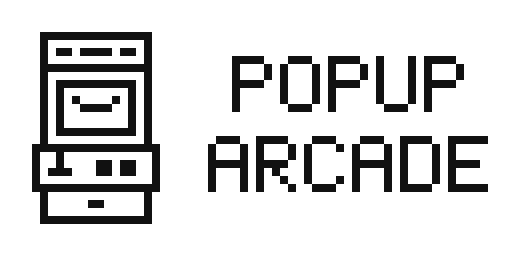
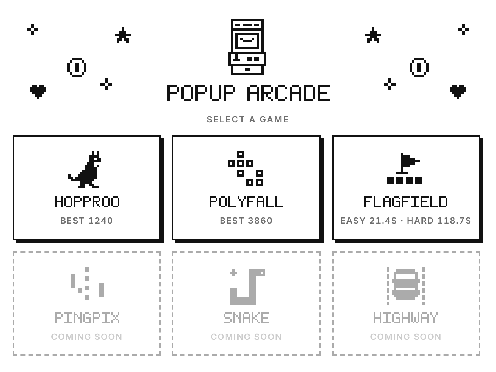
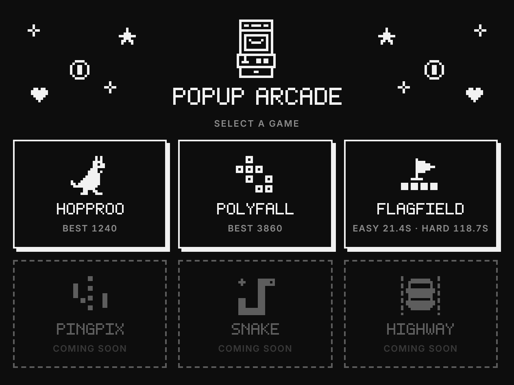
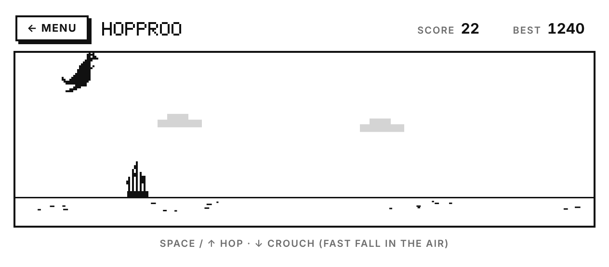
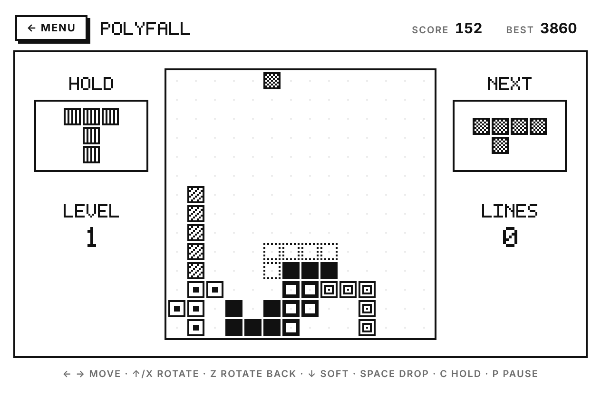
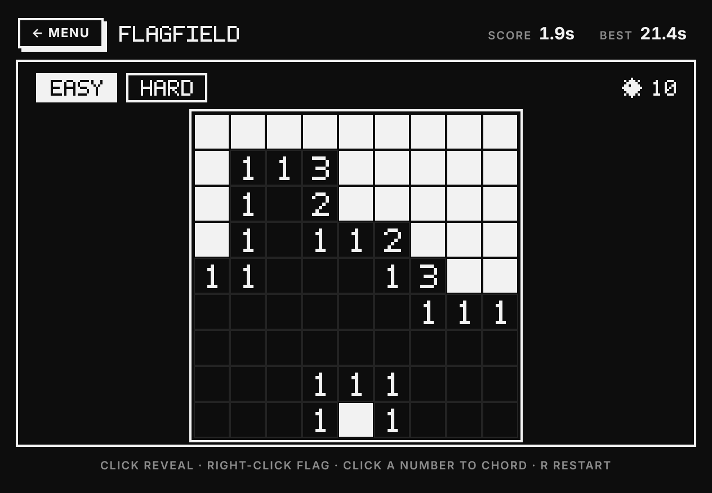

<p align="center">
  <picture>
    <source media="(prefers-color-scheme: dark)" srcset="docs/logo-dark.png">
    
  </picture>
</p>

<p align="center">
  Tiny pixel-art arcade games that live in your Chrome toolbar.<br>
  Click the icon, pick a game, beat your best.
</p>

<p align="center">
  
  
  
</p>

<p align="center">
  
  
</p>

## Games

### Hopproo
An endless runner starring a pixel kangaroo. Hop over rocks and bushes, crouch under birds and see how far you can go as the outback speeds up.



### Polyfall
A falling-piece puzzle built only from 3-cell and 5-cell pieces on a 14×14 square field. Every piece type has its own pixel pattern, with ghost piece, hold and next preview.



### Flagfield
Reveal the field without hitting a mine. Easy (9×9) and Hard (16×16) modes, safe first click, flags and chording, with a best time for each difficulty.



### Coming soon
Pingpix, Snake and Highway.

## Controls

| Game | Controls | Score |
| --- | --- | --- |
| Hopproo | Space / ↑ hop, ↓ crouch (fast fall in the air) | Distance |
| Polyfall | ← → move, ↑ / X rotate, Z rotate back, ↓ soft drop, Space hard drop, C hold, P pause | Points |
| Flagfield | Click reveal, right-click / Shift+click flag, click a number to chord, R restart | Best time per difficulty |

## Features

- Black and white pixel-art style, in light and dark mode
- High scores saved locally with `chrome.storage.local`, nothing leaves your browser
- Only the `storage` permission, no network access, no tracking ([privacy policy](PRIVACY.md))
- Works offline
- Respects reduced-motion settings

## Install

### From source
1. Download or clone this repository
2. Open `chrome://extensions`
3. Enable **Developer mode**
4. Click **Load unpacked** and select the project folder

## Project structure

```
manifest.json
popup.html / popup.css / popup.js   menu, score bar, game lifecycle
core/registry.js                    games shown in the menu (+ coming soon cards)
core/storage.js                     high scores in chrome.storage.local
core/canvas-ui.js                   shared canvas palette, frames and message boxes
core/pixels.js                      pixel font, logos, icons and decorations (single source)
games/*.js                          one module per game
tools/build-icons.mjs               generates icons/ and assets/ from core/pixels.js
assets/                             wordmark PNGs (stacked / row, black / white)
docs/                               README images
```

## Pixel art

All pixel art lives in `core/pixels.js` as `#` / `.` grids. The popup renders them as SVG and the games draw them on canvas. After changing a grid, regenerate the PNG icons and wordmarks:

```
node tools/build-icons.mjs
```

## Adding a game

Create `games/<name>.js` exporting:

```js
export default {
  id: 'snake',
  name: 'Snake',
  icon: 'snake',
  width: 600,
  height: 400,
  scoreOrder: 'desc',
  controls: 'Arrow keys move',
  start({ canvas, ctx, width, height }, api) {},
  stop() {},
};
```

Add a 16×16 grid with the same key to `ICONS` in `core/pixels.js`, then add the game to `games` in `core/registry.js` (and remove it from `upcoming`).

`api` provides `setScore(value)`, `submit(value)` (returns `true` on a new high score), `getHigh()`, `setMode(mode)` for per-mode records and `flush()` to save immediately. Set `scoreOrder: 'asc'` when lower is better, `format(value)` for custom display and `modes: [{ id, label }]` to show per-mode bests on the menu card.

## Changelog

See [CHANGELOG.md](CHANGELOG.md).

## License

The source code is licensed under the [GNU General Public License v3.0](LICENSE).

The name "Popup Arcade", the game names and the Popup Arcade logo are not covered by this license. Forks and derivative works must use their own name and logo.
